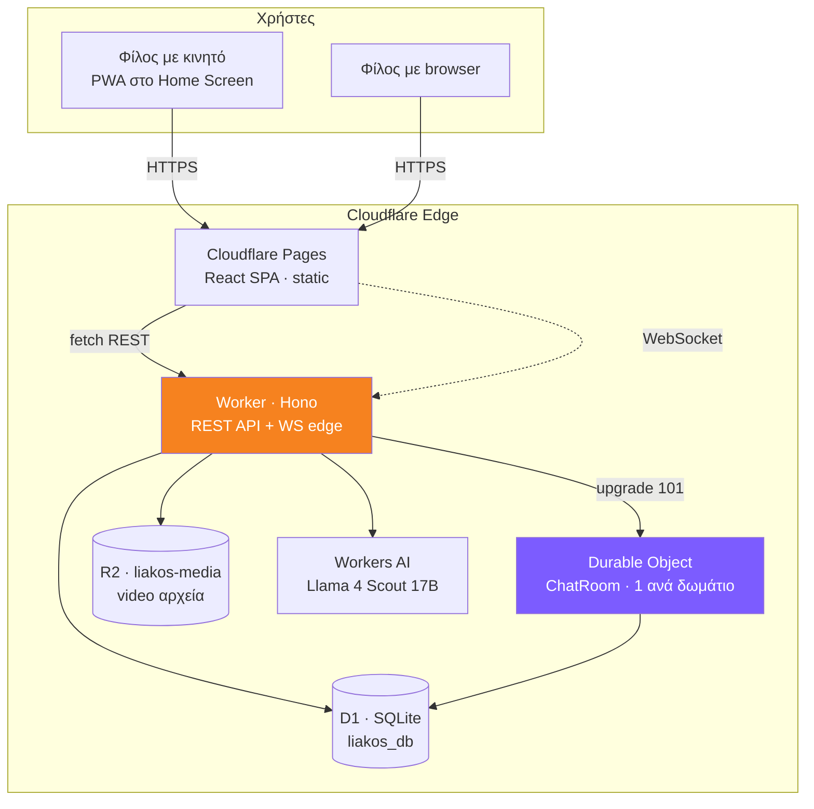
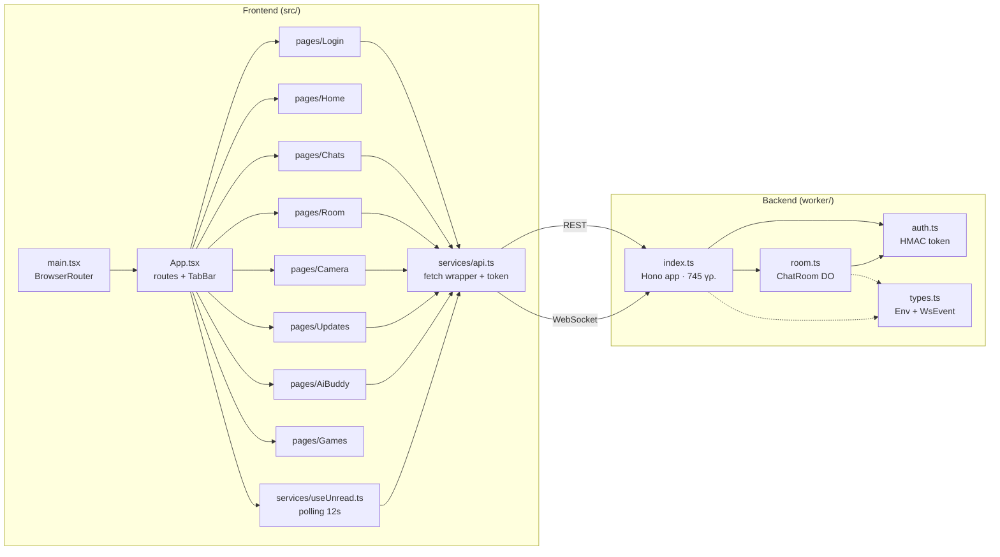
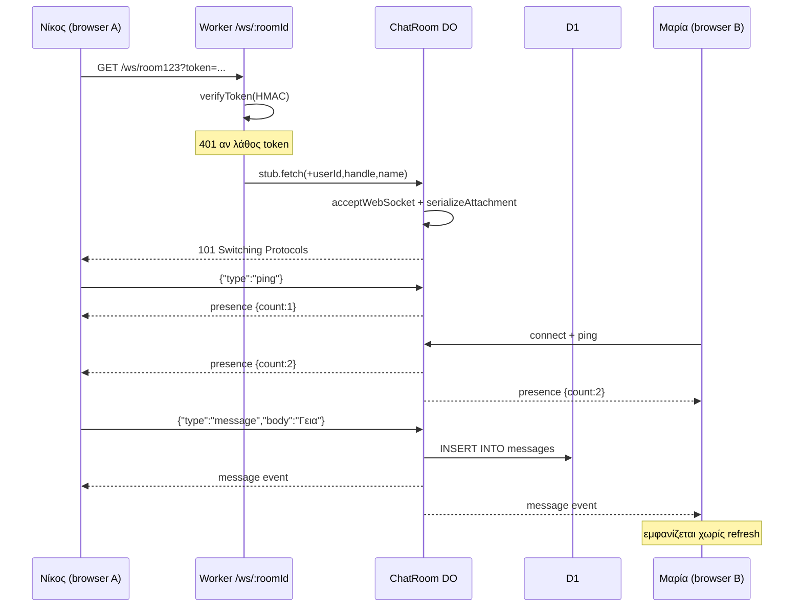
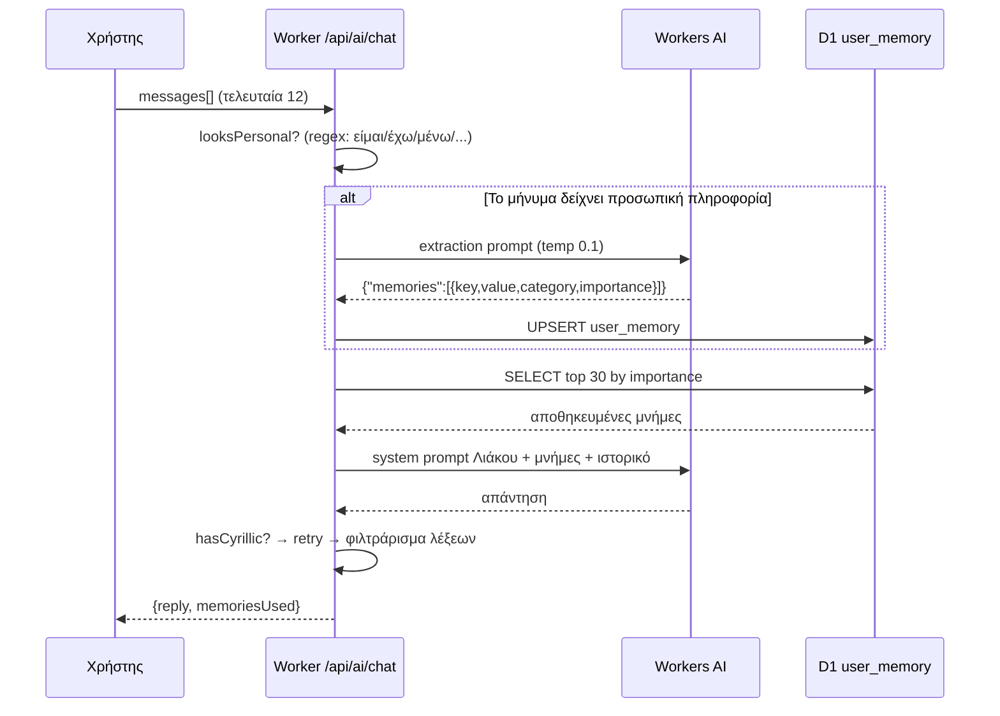
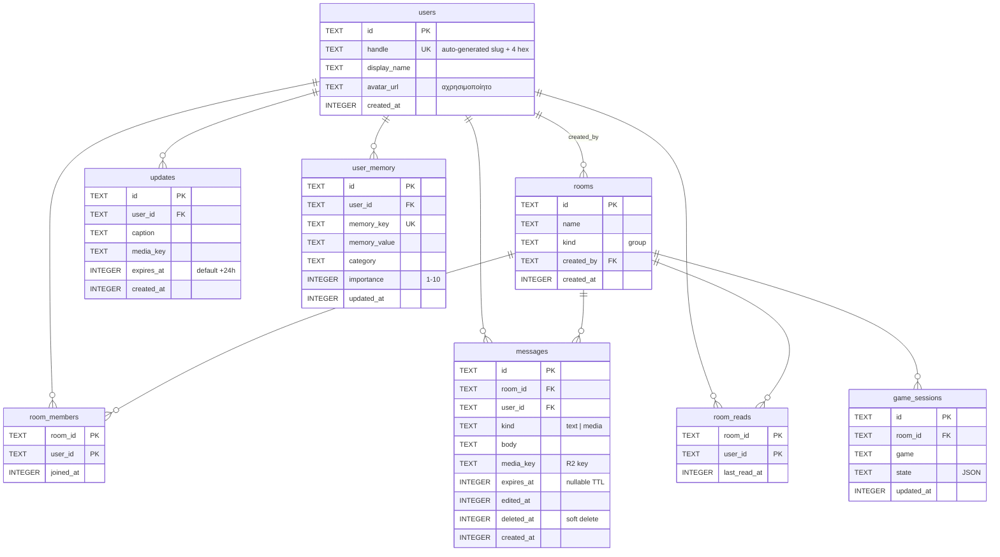
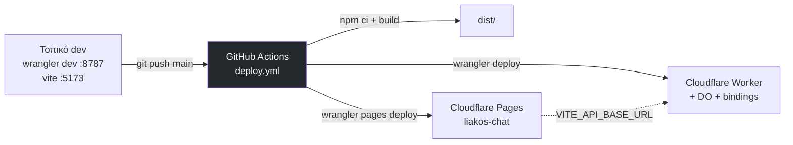
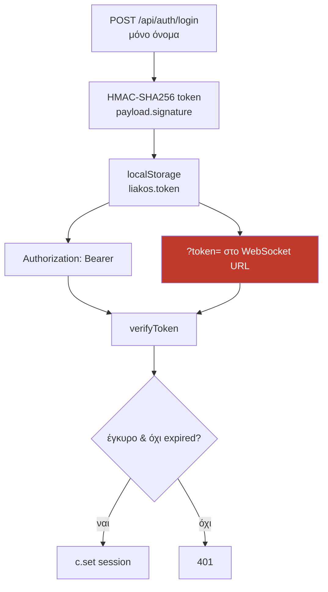

# Liakos Chat — Αρχιτεκτονική

**Έκδοση κώδικα:** v1.3.0 · **Ημερομηνία:** 6 Σεπτεμβρίου 2026
**Repo:** `nkourouklis-dev/liakos-chat` · **Worker:** `liakos-chat.nkourouklis.workers.dev`

> Τα διαγράμματα είναι σε Mermaid. Το GitHub τα κάνει render αυτόματα μέσα στο repo.
> Αν θες εικόνα, υπάρχει και το `liakos-architecture.svg`.

---

## 1. Διάγραμμα συστήματος (System Context)

**Το κλειδί:** ο Worker είναι stateless — δεν κρατάει ανοιχτά sockets. Το Durable Object είναι
ένα ζωντανό instance ανά δωμάτιο που κρατάει τα WebSockets και κάνει fan-out. Χωρίς αυτό
δεν υπάρχει real-time.

---

## 2. Component diagram — τι μιλάει με τι

---

## 3. Ροή real-time μηνύματος (Sequence)

**Κρίσιμη λεπτομέρεια στον κώδικα:** το route `/ws/:roomId` δηλώνεται **πάνω** από το CORS
middleware. Μια απάντηση 101 έχει immutable headers — αν το CORS προσπαθήσει να γράψει
header μετά, σκάει η σύνδεση. Γι' αυτό υπάρχει και ο έλεγχος `c.res.status !== 101`.

---

## 4. Ροή AI με μνήμη (Sequence)

Το `looksPersonal` gate υπάρχει για κόστος: το extraction είναι **δεύτερη** κλήση AI.
Τρέχει μόνο όταν το μήνυμα είναι >25 χαρακτήρες και ταιριάζει σε regex.

---

## 5. Μοντέλο δεδομένων (D1)

**Σημείωση:** δεν υπάρχουν FOREIGN KEY constraints στο schema — μόνο λογικές σχέσεις.
Ο πίνακας `game_sessions` έχει δημιουργηθεί αλλά **δεν χρησιμοποιείται πουθενά** ακόμη.

### Migrations

| Αρχείο | Τι πρόσθεσε |
|---|---|
| `0001_init.sql` | users, rooms, room_members, messages, updates, game_sessions |
| `0002_memory.sql` | user_memory (πρώτη προσπάθεια) |
| `0003_fix_user_memory.sql` | DROP + ξαναφτιάξιμο του user_memory |
| `0004_room_reads.sql` | room_reads — παρακολούθηση αδιάβαστων |
| `0005_message_edits.sql` | `edited_at`, `deleted_at` στα messages |
| `0006_workspaces_ai_settings.sql` | `workspaces`, `users.workspace_id/role`, `user_ai_settings` (βλ. `05_WORKSPACES_AND_AI.md`) |

---

## 6. Deployment / CI-CD

**Secrets που χρειάζονται:**

| Πού | Όνομα | Τι είναι |
|---|---|---|
| GitHub → Actions Secrets | `CLOUDFLARE_API_TOKEN` | για τα deploys |
| GitHub → Actions Secrets | `CLOUDFLARE_ACCOUNT_ID` | account id |
| Cloudflare Worker secret | `JWT_SECRET` | υπογραφή HMAC token |
| Cloudflare Pages env var | `VITE_API_BASE_URL` | το URL του Worker (build-time!) |
| Τοπικά `.dev.vars` | `JWT_SECRET` | τοπικό secret, **ποτέ στο git** |

⚠️ Το `VITE_API_BASE_URL` μπαίνει στο bundle σε **build time**. Αν το αλλάξεις,
πρέπει να ξανακάνεις build + deploy — δεν αρκεί το restart.

---

## 7. Χάρτης API

| Method | Route | Auth | Τι κάνει |
|---|---|:--:|---|
| GET | `/health` | — | health check |
| POST | `/api/auth/login` | — | δημιουργεί χρήστη + token (365 μέρες). Νέα παρέα (`workspaceName`) ή είσοδος με `inviteCode`/`roomId` |
| GET | `/api/workspace` | ✅ | όνομα παρέας, invite code, ρόλος |
| PATCH | `/api/workspace` | ✅ | μετονομασία παρέας — **μόνο admin** |
| GET | `/ws/:roomId` | token | WebSocket upgrade → Durable Object |
| GET | `/api/rooms` | ✅ | τα δωμάτιά μου |
| POST | `/api/rooms` | ✅ | νέο δωμάτιο (γίνομαι owner + member) |
| GET | `/api/rooms/:id` | ✅ | στοιχεία δωματίου |
| PATCH | `/api/rooms/:id` | ✅ | μετονομασία — **μόνο owner** |
| DELETE | `/api/rooms/:id` | ✅ | owner → σβήνει για όλους · άλλος → αποχωρεί |
| POST | `/api/rooms/:id/join` | ✅ | είσοδος με invite link — **μόνο από την ίδια παρέα** |
| GET | `/api/rooms/:id/messages` | ✅ | τελευταία 100, χωρίς deleted/expired |
| GET | `/api/unread` | ✅ | σύνολο + ανά δωμάτιο |
| POST | `/api/rooms/:id/read` | ✅ | σφράγισμα «διαβάστηκε» |
| POST | `/api/media` | ✅ | upload στο R2 → επιστρέφει key |
| GET | `/api/media/:userId/:file` | ❌ | σερβίρει video, με Range support |
| GET | `/api/updates` | ✅ | ενεργά updates της **παρέας μου** (expires_at > τώρα) |
| POST | `/api/updates` | ✅ | νέο update, default TTL 24h |
| DELETE | `/api/updates/:id` | ✅ | μόνο δικό μου, σβήνει και το R2 object |
| POST | `/api/ai/chat` | ✅ | ο AI μου (δικό μου key, ή ενσωματωμένος αν το workspace το επιτρέπει) + μνήμη · 409 αν ανενεργός |
| GET/PUT/DELETE | `/api/ai/settings` | ✅ | provider, όνομα bot, API key (κρυπτογραφημένο, δεν επιστρέφεται) |
| GET | `/api/ai/memory` | ✅ | τι θυμάται για μένα |
| DELETE | `/api/ai/memory/:key` | ✅ | σβήνει μία μνήμη |
| DELETE | `/api/ai/memory` | ✅ | σβήνει όλες |

### WebSocket events

**Client → Server:** `ping`, `message`, `edit`, `delete`, `typing`, `game`
**Server → Client:** `message`, `edit`, `delete`, `presence`, `typing`, `game`, `error`

Τα `typing` και `game` **υποστηρίζονται ήδη από τον server** αλλά δεν είναι συνδεδεμένα
στο UI. Είναι δωρεάν feature — μόνο frontend δουλειά.

---

## 8. Ασφάλεια — τι ισχύει σήμερα

**Τι είναι εντάξει:** HMAC υπογραφή με WebCrypto, χωρίς εξωτερικά libs. Το `WHERE user_id = ?`
στα edit/delete εμποδίζει κάποιον να πειράξει ξένο μήνυμα ακόμη κι αν στείλει χειροκίνητα
το event. Το CORS δέχεται μόνο localhost + `*.pages.dev`.

**Τι δεν είναι:** αναλυτικά στο `04_PRODUCT_OWNER_MANUAL.md`, ενότητα «Ρίσκα».
